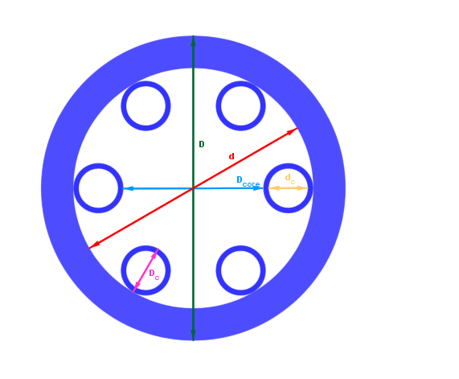

[](https://zenodo.org/badge/latestdoi/228352833)

# Tubular Anti-resonant Hollow-core fibers drawing simulation

### Description

This application allows to compute the drawing parameters to realize a tubular hollow-core optical fiber. 

The method used in this software is that described in the paper of Jasion *et al.* [[1]](#1) with a minor corrections: equation 3 has been modified as follow to take into account the fact that the black body radiation is a surface phenomenom and not a volume phenomenom.

<h3 align="center">
 $\frac{\left(R_j^2-r_j^2\right)}{2}\rho c_p w \frac{dT}{dz}=R_j N \left(T_a-T\right)+R_j \sigma \left(\alpha(T_a)T_a^4-\alpha(T)T^4\right)$
</h3>
 
- The tab "Direct computation" computes the evolution of all the structural fiber parameters during the drawing process with the input chosen by the user.
- The tab "Optimization" computes the pressures and the furnace temperature that allow to obtain a target fiber from a given preform.
- The tab "Parameters" (version >1.3) allows to modify the materials properties that can depends on the temperature.
- The Python port adds a "Jacket" tab (preform geometry + live material-law previews)
  and a "Capillaries" tab (Ncap azimuthal capillaries and 1-3 nested rings with
  live red/green contact badges), a 12-view plot area with a z-scrubbed
  cross-section schematic, `.json` config save/load, `.csv`/`.txt` result export,
  and a crash-proof diagnostic banner with actionable advice on failed draws.
- A dedicated "Cane & Stack" scaling tab performs bidirectional 1-3 ring
  cane/stack sizing (see [`./doc/cane_scaling_guidelines.md`](./doc/cane_scaling_guidelines.md)).

### Getting Started

The Python port is a **desktop application** (PySide6 + NumPy/SciPy) that runs on
macOS, Linux, and Windows. No prior Python experience is required — follow the
steps below in order.

#### Step 1 — Download the code

**With Git** (recommended):

```bash
git clone https://github.com/nhj717/HARF-drawing.git
cd HARF-drawing
```

**Without Git**: go to
[https://github.com/nhj717/HARF-drawing](https://github.com/nhj717/HARF-drawing),
click the green **`<> Code`** button, choose **Download ZIP**, then unzip the
archive and open the resulting `HARF-drawing-main` folder. All commands below
must be run from inside that folder.

#### Step 2 — Option A (recommended): install and run with `uv`

[`uv`](https://docs.astral.sh/uv/) is a single small program that automatically
downloads the right Python (3.12+), creates an isolated environment, and
installs every dependency for you — no manual Python setup needed.

**Install `uv`** (only once per machine):

- macOS or Linux — either command works:

  ```bash
  curl -LsSf https://astral.sh/uv/install.sh | sh
  ```

  ```bash
  brew install uv
  ```

- Windows (PowerShell):

  ```powershell
  powershell -ExecutionPolicy ByPass -c "irm https://astral.sh/uv/install.ps1 | iex"
  ```

Then **close and reopen your terminal** (or start a new PowerShell window) so
the `uv` command is found.

**Install dependencies and launch the app**, from inside the repository folder:

```bash
uv sync                 # downloads Python 3.12+ if needed and installs everything
uv run harf-drawing      # launch the GUI
```

To start from a saved configuration:

```bash
uv run harf-drawing --config path/to/config.json
```

#### Step 3 — Option B: standard Python (`venv` + `pip`)

If you prefer not to install `uv`, you can use a regular Python installation.

1. **Install Python >= 3.12** from
   [python.org/downloads](https://www.python.org/downloads/) if needed.
   On **Windows**, tick the **"Add python.exe to PATH"** checkbox in the
   installer's first screen. Check the version:

   ```bash
   python3 --version      # macOS / Linux
   py --version           # Windows
   ```

   The output must show `3.12` or higher.

2. **Create and activate a virtual environment** (run inside the repository
   folder — the environment is a local `.venv` folder, no admin rights needed):

   ```bash
   python3 -m venv .venv
   ```

   Activate it — the exact command depends on your terminal:

   - macOS / Linux (bash or zsh):

     ```bash
     source .venv/bin/activate
     ```

   - Windows PowerShell:

     ```powershell
     .venv\Scripts\Activate.ps1
     ```

   - Windows Command Prompt (cmd.exe):

     ```cmd
     .venv\Scripts\activate.bat
     ```

   After activation your prompt is prefixed with `(.venv)`.

3. **Install the application and its dependencies**:

   ```bash
   python -m pip install --upgrade pip
   pip install -e .
   ```

4. **Launch the GUI** — either command works:

   ```bash
   harf-drawing
   python -m app.main
   ```

   (Remember to re-run the activation command from step 2 whenever you open a
   new terminal.)

To also run the tests and linter without `uv`, install the dev tools separately:

```bash
pip install pytest ruff
```

### OS Dependencies & Prerequisites

The application itself is pure Python — the only external requirements are a
Python 3.12+ interpreter (handled automatically by `uv`) and the system
libraries listed below.

- **macOS** (macOS 12+ recommended): everything is included — the Qt
  libraries are bundled with the `PySide6` package, so no extra installs are
  needed. [Homebrew](https://brew.sh/) users can also install `uv` with
  `brew install uv`.
- **Linux**: `PySide6` needs the Qt/XCB/OpenGL system libraries. Install them
  once with your distribution's package manager:

  - Debian / Ubuntu:

    ```bash
    sudo apt update && sudo apt install -y libgl1 libegl1 libxkbcommon0 \
      libxcb-cursor0 libxcb-xinerama0 libxcb-icccm4 libxcb-image0 \
      libxcb-keysyms1 libxcb-render-util0 libxcb-shape0 libdbus-1-3
    ```

  - Fedora / RHEL:

    ```bash
    sudo dnf install -y mesa-libGL mesa-libEGL libxkbcommon \
      xcb-util-cursor xcb-util-wm xcb-util-image xcb-util-keysyms \
      xcb-util-renderutil xcb-util-shape dbus-libs
    ```

  - Arch:

    ```bash
    sudo pacman -S --needed libglvnd libxkbcommon xcb-util-cursor \
      xcb-util-wm xcb-util-image xcb-util-keysyms xcb-util-renderutil \
      xcb-util-shape
    ```

  To run the test suite on a machine without a display (e.g. a server or CI),
  use the offscreen Qt platform: `QT_QPA_PLATFORM=offscreen uv run pytest`.

- **Windows** (10/11): during the Python installation, tick
  **"Add python.exe to PATH"**. If PowerShell refuses to run
  `.venv\Scripts\Activate.ps1` ("running scripts is disabled on this system"),
  run once:

  ```powershell
  Set-ExecutionPolicy -Scope CurrentUser RemoteSigned
  ```

  If the GUI fails to start with a message about missing Qt DLLs, install the
  [Microsoft Visual C++ Redistributable](https://aka.ms/vs/17/release/vc_redist.x64.exe)
  and try again.

### Troubleshooting

- **`uv: command not found` right after installing `uv`** — the terminal was
  opened before the install. Close and reopen the terminal (or PowerShell) and
  try again. Alternatively run `~/.local/bin/uv` (macOS/Linux) directly.
- **Python version too old** (`Python 3.11` or lower, or
  `requires-python >=3.12` error) — the application needs Python 3.12 or
  newer. Install it from [python.org/downloads](https://www.python.org/downloads/),
  or simply use Option A: `uv` downloads a suitable Python automatically.
- **Linux: `Could not load the Qt platform plugin "xcb"`** — the Qt/XCB system
  libraries are missing. Install the packages listed under
  *OS Dependencies & Prerequisites → Linux* for your distribution.
- **Windows: "running scripts is disabled on this system"** when activating the
  virtual environment — run
  `Set-ExecutionPolicy -Scope CurrentUser RemoteSigned` in PowerShell, then
  activate again, or use the Command Prompt activation command instead.
- **`harf-drawing: command not found` or `ModuleNotFoundError: app`** — the
  virtual environment is not active in this terminal. Re-run the activation
  command (see Step 3, option B), or launch with `python -m app.main`.

### Running Tests & Linting

With `uv`:

```bash
uv run pytest
uv run ruff check .
```

Without `uv` (inside the activated `.venv`, after `pip install pytest ruff`):

```bash
pytest
ruff check .
```

The suite covers unit, invariant, safety, I/O, and headless offscreen Qt GUI
tests.

### Original MATLAB version

The application has been designed with MATLAB R2024b with the optimization and parallel toolboxes. It can be launched directly from the source code: the main file is *HARF_drawing.mlapp*. If you do not have this matlab version/toolbox, an installation file for windows 10/11 is provided in the release. 

### Citation
If you use this software in a publication, you can cite it as follow:
O. Vanvincq, "Harf-drawing" (2019), https://doi.org/10.5281/zenodo.3582197 

### User manual

All the distances used in the program are shown in the picture below.



List of the parameters used in the program :

- *Pcore* : core pressure 
- *Pcap* : overpressure between capillaries and core
- *Feed speed* : speed of the preform 
- *Vf* : drawing speed
- *L* : computing length. must be greater than the furnace length.
- *D0* and *Df* : value of *D* at *z=0* (preform) and *z=L* (fiber)
- *Dc0* and *Dcf* : value of *Dc* at *z=0* (preform) and *z=L* (fiber)
- *d0* and *df* : value of *d* at *z=0* (preform) and *z=L* (fiber)
- *dc0* and *dcf* : value of *dc* at *z=0* (preform) and *z=L* (fiber)
- *tf* : fiber capillaries thickness, *tf=(Dcf-dcf)/2*
- *Dcore* : fiber core diameter
- *Draw tension* : draw tension at *z=L*
- *Tmax* : maximum temperature of the furnace. At *z=0*, the preform temperature is assumed to be equal to the furnace temperature decreased by 500°C.
- *Furnace length* : must be lower than *L*. The température outside the furnace is fixed to 20°C.
- *Furnace temperature profile* : function of *z* that described the evolution of the normalized furnace temperature (*T/Tmax*) between *z=0* and the *furnace length*
- *Max(Rc/Rcontact)* : if this value is greater than 1, the capillaries are in contact and the fiber is deformed.

### References

<a id="1">[1]</a> [Gregory T. Jasion, John R. Hayes, Natalie V. Wheeler, Yong Chen, Thomas D. Bradley, David J. Richardson, and Francesco Poletti "Fabrication of tubular anti-resonant hollow core fibers : modelling, draw dynamics and process optimization", Opt. Express, 27(15) :20567-20582, 2019.](https://doi.org/10.1364/OE.27.020567)
