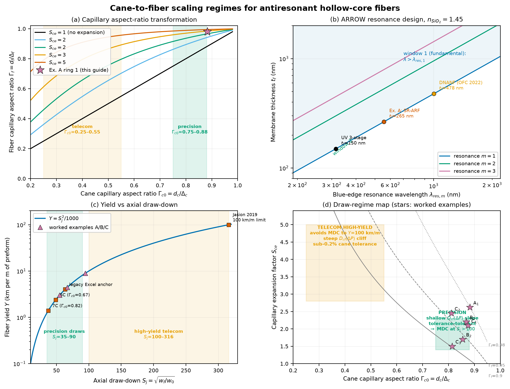

# Cane-to-Fiber and Stack-to-Cane Scaling Guidelines for Tubular and Nested Antiresonant Hollow-Core Fibers

**Scope.** Engineering & physics reference for selecting ideal cane-to-fiber and
stack-to-cane scaling factors for **Single-Ring Tubular AR-HCFs (SR-ARF, 5–8
tubes)**, **2-Ring Nested AR-HCFs (NANF, 5–6 sets)**, **3-Ring Double-Nested
AR-HCFs (DNANF, 5 sets)**, and **UV/Visible Ultra-Thin-Wall AR-HCFs (3-stage
double-cane)**. All closed-form equations below are the ones implemented by the
`HARF-drawing` *Cane & Stack* workstation tab; the worked examples can be
reproduced with the Forward / Back-Calculation and *Push to Solver Tabs* buttons.

**Conventions.** Stack, cane and jacket dimensions in **mm**; fiber dimensions in
**µm**; internal computation in SI (m). $d_i$ = ring-$i$ capillary bore (inner
diameter), $\Delta_i = d_i + 2t_i$ = capillary outer diameter, $t_i$ = wall
(membrane) thickness, $\Gamma_i = d_i/\Delta_i$ = capillary aspect ratio
(air-filling fraction), $D_{\text{core}}$ = core diameter, $\zeta = D_{\text{core}}
+ 2\Delta_1$ = largest hollow-region diameter (inner boundary of the containment
bore), $N$ = number of capillaries per ring.

---

## 1. Executive Summary

### 1.1 Ten working rules

1. **Choose $t_f$ first, from the ARROW condition**
   $\lambda_{\text{res},m} = \frac{2t_f}{m}\sqrt{n_{\text{SiO}_2}^2-1}$
   ($n_{\text{SiO}_2}\approx 1.45$, so $t_f \approx 0.477\,m\,\lambda_{\text{res},m}$).
   Operating in the fundamental window ($\lambda_0 > \lambda_{\text{res},1}$)
   with the blue edge at $\approx 0.6$–$0.65\,\lambda_0$ is the standard
   low-loss choice (C-band NANF/DNANF: $t_f \approx 470$–$500$ nm).
2. **Pick the fused-jacket aspect ratio** $d_{0,\text{eff}}/D_{0,\text{eff}} =
   \zeta_c/D_{0,\text{eff}} \in [0.28, 0.40]$; outside this band the fiber is
   either glass-starved (breakage) or glass-rich (heavy, leaky, expensive).
3. **Budget the axial draw-down** $S_j = \sqrt{w_f/w_0}$: research/precision
   draws $S_j \in [35, 90]$ ($Y = S_j^2/1000 = 1.2$–$8.1$ km/m); telecom
   high-yield $S_j \in [100, 316]$ ($Y = 10$–$100$ km/m) only with low-$\Gamma_{c0}$
   cane tubes (Section 4).
4. **Keep the cane in the precision band** $\Gamma_{c0} \in [0.75, 0.88]$ with
   moderate $S_{ce} \in [1.4, 2.3]$ unless yield forces the telecom band
   $\Gamma_{c0} \in [0.25, 0.55]$, $S_{ce} \in [2.8, 5.0]$.
5. **Stage-1 stack-to-cane** $S_{\text{stack}} \in [4, 9]$ drawn unpressurized
   (or minimal vacuum): $S_{ie,\text{st}} \approx S_{ce,\text{st}} \approx 1$;
   the stack jacket ID simply equals the scaled $\zeta_c$.
6. **Core bore expansion** $S_{ie} = \zeta_f / (\zeta_c/S_c) \in [1.30, 1.85]$;
   higher values thin the cane sleeve faster than the tubes and starve the
   jacket.
7. **Nested fibers need per-ring expansion** $S_{ce,i}$, never a single value;
   the nesting-clearance constraint $\nu_{c,i} = \Delta_{c,i}/d_{c,i-1} < 0.85$
   fixes the *ratio* $S_{ce,i}/S_{ce,i-1}$ (Section 5).
8. **Pressure cascade** in nested draws: $P_{\text{cap},3} > P_{\text{cap},2} >
   P_{\text{cap},1} > P_{\text{core}}$, i.e. every $\Delta P_i > 0$.
9. **Always verify with the ODE solver**: push the cane into the solver tabs and
   confirm $\max_z R_{c,1}(z)/R_{\text{contact}}(z) < 1$ (no mid-draw contact)
   and all RatioBadges green before committing glass.
10. **Ultra-thin membranes ($t_f < 350$ nm) for UV/visible do not survive a
    single high-$S_j$ draw**; use the 3-stage double-cane strategy
    (Section 4.7).

### 1.2 Recommended scaling regimes (Table 1)

| Parameter | SR-ARF (5–8 tubes) | NANF (2-ring, 5–6 sets) | DNANF (3-ring, 5 sets) | UV/Vis ultra-thin (3-stage) |
|---|---|---|---|---|
| Stage-1 $S_{\text{stack}}$ (unpressurized) | 4–9 | 4–7 | 4–6 | 4–6 per stage |
| Cane OD (sleeved), mm | 3–8 | 5–9 | 5–10 | 1st cane 8–15, 2nd cane 2–4 |
| Sleeving jacket OD/ID, mm | 10–30 / 3–15 | 20–30 / 15–25 | 14–25 / 10–15 | 1st stage 25–40 / 15–25 |
| Fused aspect $d_{0,\text{eff}}/D_{0,\text{eff}}$ | 0.28–0.40 | 0.28–0.35 | 0.28–0.35 | 0.28–0.40 |
| Axial draw-down $S_j$ (precision) | 35–90 | 35–90 | 35–90 | 20–60 per stage |
| Axial draw-down $S_j$ (telecom) | 100–316 (MDC risk) | 100–316 (MDC risk) | 100–316 | not used |
| Yield $Y = S_j^2/1000$ (km/m) | 1.2–8 (100 max) | 1.2–9 (100 max) | 1.2–9 (100 max) | ~0.4–3.6 per stage |
| Core expansion $S_{ie}$ | 1.30–1.85 | 1.45–1.80 | 1.45–1.60 | 1.3–1.7 per stage |
| Capillary expansion $S_{ce,1}$ | 1.4–2.6 | 2.0–2.4 | 2.0–2.4 | 1.4–2.2 per stage |
| Capillary expansion $S_{ce,2}$ | — | 1.5–1.8 | 1.8–2.6 (z2: matched/raised) | — |
| Capillary expansion $S_{ce,3}$ | — | — | 1.15–1.5 | — |
| Cane aspect $\Gamma_{c0,1}$ | 0.70–0.88 | 0.82–0.88 | 0.80–0.88 | 0.75–0.88 |
| Cane aspects $\Gamma_{c0,2}, \Gamma_{c0,3}$ | — | 0.80–0.87 | 0.78–0.85, 0.75–0.82 | — |
| Typical $\delta D_c/D_c$ tolerance needed | 0.5–1% | 0.3–0.8% | 0.3–0.8% | <0.5% |
| Draw tension $\tau_f$ (precision band) | 0.2–0.45 kgf | 0.25–0.45 kgf | 0.3–0.45 kgf | ~250 MPa stress |

### 1.3 ARROW membrane-thickness targets (Table 2)

With $n_{\text{SiO}_2} = 1.45$, $2\sqrt{n^2-1} = 2.098$, the resonances
(loss peaks) of a silica membrane sit at
$\lambda_{\text{res},m} = 2 t_f \sqrt{n^2-1}/m$; the $m$-th antiresonant
**window** is $\lambda \in (\lambda_{\text{res},m+1},\, \lambda_{\text{res},m})$,
with window 1 the open band $\lambda > \lambda_{\text{res},1}$.

| Target band | Window | Blue edge $\lambda_{\text{res}}$ | $t_f$ (nm) | Reference fiber |
|---|---|---|---|---|
| C/L-band telecom (1550 nm) | 1 | ~1000 nm | 470–500 | DNANF, 0.174 dB/km (OFC 2022) |
| NIR / 1064 nm delivery | 1 | 550–650 nm | 260–310 | Ex. A (this guide) |
| 600–1100 nm broadband | 1 | ~556 nm | 265 | NANF-A/B/C (Sakr 2020) |
| Visible 400–600 nm | 1 | 315–400 nm | 150–190 | thin-wall ARF |
| UV-A/UV-B 250–400 nm | 1 | ~315 nm | 150 (→90 for 190 nm) | 3-stage double-cane |
| 800 nm in higher window | 2 | ~600 nm | ~570 | thicker, easier draw |

Rule of thumb: **window 1 with the blue edge at 0.6–0.65 $\lambda_0$**
maximizes bandwidth and margin against wall-thickness drift; windows 2–3
($t_f \approx 0.95\,\lambda_{\text{res}}$, $1.43\,\lambda_{\text{res}}$) double
or triple the membrane for the same band at the cost of a narrower window and
higher overlap loss.

---

## 2. Notation and Geometry Conventions

| Symbol | Meaning | Units |
|---|---|---|
| $d_i, \Delta_i, t_i$ | ring-$i$ bore, OD, wall; $\Delta_i = d_i + 2t_i$ | mm (cane/stack), µm (fiber) |
| $\Gamma_i = d_i/\Delta_i$ | ring-$i$ aspect ratio (air-filling fraction) | – |
| $D_{\text{core}}, \zeta$ | core diameter; largest hollow region $\zeta = D_{\text{core}} + 2\Delta_1$ | µm/mm |
| $\text{OD}_j, \text{ID}_j$ | sleeving jacket OD / ID | mm |
| $\text{OD}_c$ | cane outer diameter (with sleeve) | mm |
| $D_{0,\text{eff}}$ | fused (vacuum-collapsed) jacket effective OD, Eq. (12) | mm |
| $S_{\text{stack}}$ | stage-1 stack→cane linear draw-down | – |
| $S_c, S_j$ | cane→fiber and jacket→fiber linear draw-downs | – |
| $S_{ie}$ | core bore expansion, $=\zeta_f/(\zeta_c/S_c)$ | – |
| $S_{ce,i}$ | ring-$i$ capillary expansion, $=d_{f,i}/(d_{c,i}/S_c)$ | – |
| $Y = S_j^2/1000$ | fiber yield | km per m preform |
| $\eta = d_1/D_{\text{core}}$ | core-fill ratio | – |
| $\nu_i = \Delta_i/d_{i-1}$ | ring-$i$ nesting clearance inside ring $i\!-\!1$ | – |
| $\delta = \sin(\pi/N)(D_{\text{core}}+\Delta_1) - \Delta_1$ | azimuthal inter-tube gap | µm/mm |
| $\gamma = 100(\Delta_1^2 - d_1^2)/(\text{OD}_{\text{ref}}^2-\zeta^2)$ | ring-1 glass / containment glass mass ratio | % |
| $R_{\text{contact}} = r\,\sin(\pi/N)/(1+\sin(\pi/N))$ | contact radius of the tube ring inside bore $d = 2r$ | µm |

The tube ring convention (matching the workstation schematic): every ring-1
tube is **externally tangent to the containment bore** ($\text{ID} = \zeta$ for
stack, cane sleeve and jacket), rings 2 and 3 nest inside rings 1 and 2 with
centers stepped outward along the same azimuth:
$\rho_0 = r - R_{c,1}$, $\rho_i = \rho_{i-1} + r_{c,i} - R_{c,i+1}$.

---

## 3. Mass-Conservation Scaling Theory

### 3.1 Two-stage stack-and-draw kinematics

The full fabrication chain is

$$
\text{Primary stack} \xrightarrow{\;S_{\text{stack}}\;}
\text{Cane (+ sleeve, + jacket)} \xrightarrow{\;S_j,\;S_c,\;S_{ie},\;S_{ce,i}\;}
\text{Fiber},
$$

with an axial draw-down defined through the feed/draw speeds,
$S_j = \sqrt{w_f/w_0}$ (area × velocity conservation gives length ratio
$w_f/w_0 = S_j^2$, hence $Y = S_j^2/1000$ km of fiber per m of preform).
Everything else in this section is **silica area conservation**: under a pure
axial draw-down $S$, every area element scales by $1/S^2$; under gas-pressure
expansion of a bore, the glass area $\text{OD}^2 - \text{ID}^2$ of the
surrounding wall is conserved while the bore grows.

### 3.2 The five scaling stages (E → F → G → H, desired I)

`HARF-drawing` organizes the cane→fiber transformation as four computed states
plus the user's target state **I**:

**Stage E — initial cane & jacket** (measured or back-calculated):

$$
\Delta_{E,i} = d_{c,i} + 2t_{c,i}, \qquad
\zeta_E = D_{\text{core},c} + 2\Delta_{E,1}.
$$

**Stage F — unexpanded draw** (pure axial scaling by the cane draw-down
$S_c$; *no pressurization*):

$$
(d_{F,i},\, t_{F,i},\, \Delta_{F,i},\, \zeta_F,\, D_{\text{core},F},\,
\text{OD}_{\text{cane},F},\, \text{ID}_{j,F},\, \text{OD}_{j,F})
= (\dots)_E / S_c ,
$$

with the silica-area invariants $S_c^2(\Delta_{F,i}^2 - d_{F,i}^2) =
\Delta_{E,i}^2 - d_{E,i}^2$.

**Stage G — core bore expansion** (pressurize the core; the hollow region
inflates by $S_{ie}$ while every glass annulus keeps its area):

$$
\zeta_G = S_{ie}\,\zeta_F, \qquad
D_{\text{core},G} = \zeta_G - 2\Delta_{F,1},
$$

$$
\text{OD}_{\text{cane},G} = \sqrt{\text{OD}_{\text{cane},F}^2 - \zeta_F^2 + \zeta_G^2},
\qquad
\text{OD}_{j,G} = \sqrt{\text{OD}_{j,F}^2 - \zeta_F^2 + \zeta_G^2},
\qquad \text{ID}_{j,G} = \text{OD}_{\text{cane},G}.
$$

**Stage H — per-ring capillary expansion** (pressurize each capillary ring by
its own $S_{ce,i}$; wall area of ring $i$ conserved):

$$
d_{H,i} = S_{ce,i}\, d_{F,i}, \qquad
\Delta_{H,i} = \sqrt{\Delta_{F,i}^2 - d_{F,i}^2 + d_{H,i}^2}, \qquad
t_{H,i} = \frac{\Delta_{H,i} - d_{H,i}}{2},
$$

$$
\zeta_H = \zeta_G, \qquad
D_{\text{core},H} = \zeta_H - 2\Delta_{H,1}, \qquad
(\text{OD}_{\text{cane}}, \text{ID}_j, \text{OD}_j)_H = (\dots)_G .
$$

State **H is the predicted fiber**; state **I** holds the desired fiber, and the
back-calculation of Section 3.6 solves E from I.

### 3.3 Aspect-ratio transformation

The single most useful identity of the cascade: for each ring,
$\Gamma = d/\Delta$ transforms under capillary expansion as

$$
\boxed{\;\frac{1 - \Gamma_{c0,i}^2}{\Gamma_{c0,i}^2}
= S_{ce,i}^2\,\frac{1 - \Gamma_{f,i}^2}{\Gamma_{f,i}^2}\;}
\qquad \Gamma_i \equiv \frac{d_i}{\Delta_i},
$$

where $\Gamma_{c0}$ is the aspect ratio of the *axially drawn* cane tube (stage
F) and $\Gamma_f$ that of the final fiber. **Derivation:** wall-area
conservation gives $\Delta_H^2 - d_H^2 = \Delta_F^2 - d_F^2$; divide by
$d_H^2 = S_{ce}^2 d_F^2$:

$$
\frac{\Delta_H^2 - d_H^2}{d_H^2} = \frac{1}{S_{ce}^2}\,
\frac{\Delta_F^2 - d_F^2}{d_F^2}
\;\Longleftrightarrow\;
\frac{1-\Gamma_f^2}{\Gamma_f^2} = \frac{1}{S_{ce}^2}\,
\frac{1-\Gamma_{c0}^2}{\Gamma_{c0}^2}.
$$

Inversions (both used throughout this guide):

$$
\Gamma_{f,i} = \left[1 + \frac{1}{S_{ce,i}^2}
\left(\frac{1}{\Gamma_{c0,i}^2} - 1\right)\right]^{-1/2},
\qquad
\Gamma_{c0,i} = \left[1 + S_{ce,i}^2
\left(\frac{1}{\Gamma_{f,i}^2} - 1\right)\right]^{-1/2}.
$$

Figure 1(a) plots this family. Note the strong asymmetry: at $\Gamma_{c0} =
0.88$ the curve is nearly flat (expansion "freezes" the tube geometry — the
basis of the precision regime), while at $\Gamma_{c0} < 0.55$ even moderate
$S_{ce}$ swings $\Gamma_f$ violently (the telecom cliff).

### 3.4 Co-fed vacuum collapse vs legacy Excel coupling

Two physically different ways to sleeve a cane inside a jacket:

**Option A — co-fed vacuum collapse (`CO_FED_VACUUM`, default).** The cane is
fed through the jacket and the jacket–cane annulus is evacuated, so the jacket
fuses onto the cane at (or before) the hot zone. Cane and jacket are drawn as a
*single composite*:

$$
S_c = S_j, \qquad
D_{0,\text{eff}} = \sqrt{\text{OD}_j^2 - \text{ID}_j^2 + \text{OD}_c^2},
\qquad
\text{OD}_{j,F} = \frac{D_{0,\text{eff}}}{S_j}, \qquad
\text{ID}_{j,F} = \text{OD}_{\text{cane},F} = \frac{\text{OD}_c}{S_j}.
$$

This matches single-feed draw towers and the `HARF-drawing` ODE solver, whose
jacket states $(R, r)$ obey $R^2 - r^2 = \Delta_{J0}/w$ with the bore $r$
mapped to the cane hollow region — the solver bridge sets Jacket
$(D_0, d_0) = (D_{0,\text{eff}}, \zeta_c)$. Area conservation holds exactly at
every stage: $S_j^2(\text{OD}_{j,X}^2 - \zeta_X^2) = (\text{OD}_j^2 -
\text{ID}_j^2) + (\text{OD}_c^2 - \zeta_c^2)$ for $X \in \{F, G, H\}$.

**Option B — legacy Excel coupling (`LEGACY_EXCEL`,
`reference/6Ring_Scaling.xlsx`).** The annular gap is *not* evacuated; instead
the bookkeeping assumes the jacket ID and cane OD converge geometrically and
coincide exactly at the unexpanded fiber scale,
$\text{ID}_{j,F} = \text{OD}_{\text{cane},F}$, which forces

$$
S_c = S_j\,\frac{\text{OD}_c}{\text{ID}_j}, \qquad
\text{OD}_{j,F} = \frac{\text{OD}_j}{S_j}, \qquad
\text{ID}_{j,F} = \frac{\text{ID}_j}{S_j}.
$$

Option B is a kinematic assumption, not a force balance: it never asks *where*
the gap actually closes and it decouples $S_c$ from mass conservation.
Verified against the workbook: with $\text{OD}_j = 10$ mm, $\text{ID}_j = 3$ mm,
$\text{OD}_c = 2296.296$ µm one gets $S_c = 63.5 \times 2296.296/3000 =
48.604932$, and the E→F→G→H cascade reproduces the worksheet exactly
($\zeta_G = 92.5614$ µm, $\text{OD}_{j,H} = 175.4455$ µm, $d_{H,1} = 25.9278$
µm, $t_{H,1} = 265.289$ nm, $D_{\text{core},H} = 39.6446$ µm). Prefer Option A
for new designs; keep Option B only to reproduce legacy worksheets.

### 3.5 The `cane 20180212` inconsistency ($\text{OD}_c < \zeta_c$)

The `cane 20180212` worksheet entry — $D_c = 1381.945$ µm, $d_c = 481$ µm,
$t_c = 32$ µm, $\text{OD}_c = 2296.296$ µm — is **geometrically impossible**:

$$
\zeta_c = D_c + 2(d_c + 2t_c) = 1381.9 + 2(545) = 2471.9\ \mu\text{m}
> \text{OD}_c = 2296.3\ \mu\text{m},
$$

i.e. the six-tube ring plus core spans a wider circle than the cane itself.
The worksheet's own mass ratio confirms it: $\gamma_E = 100\,
(545^2 - 481^2)/(2296.3^2 - 2471.9^2) = \mathbf{-7.84\%}$ — a *negative*
silica area. The `cane 20180314` parameter set recorded on the same sheet
($D_c = 1568$ µm, $d_c = 288$ µm, $t_c = 16.1$ µm, $\text{OD}_c = 2860$ µm)
*is* consistent: $\zeta_c = 1568 + 2(320.2) = 2208.4$ µm $< \text{OD}_c$,
leaving a positive 326 µm sleeve wall.

**Why the legacy workbook allows this:** the Option-B coupling only constrains
the *ratio* $\text{OD}_c/\text{ID}_j$; $\text{OD}_c$, $D_c$, $d_c$, $t_c$ are
entered independently (measured on different canes or at different axial
stations), and no containment check ($\zeta_c + 2t_{\text{sleeve}} \le
\text{OD}_c$, $\gamma > 0$) is enforced — the negative $\gamma$ is printed as a
plain number, not flagged. The inconsistency also poisons the stack stage: with
$S_{ie,\text{st}} = 1$ the back-computed stack would need
$\text{ID}_{\text{stack}} = S_{\text{stack}}\zeta_c >
S_{\text{stack}}\text{OD}_c = \text{OD}_{\text{stack}}$, a jacket with ID > OD.
`HARF-drawing`'s feasibility diagnostics (RatioBadges on $\gamma$, $\zeta$
containment, $\nu_i$, $\delta$) turn these silent errors into red flags.

### 3.6 Back-calculation: Fiber → Cane → Primary Stack

Given the fiber targets $(D_{\text{core},f}, D_f, d_{f,i}, t_{f,i})$ (all
derived from $\lambda_0$ as in Table 2) and the chosen expansion factors
$(S_{ie}, S_{ce,i})$, define

$$
\zeta_f = D_{\text{core},f} + 2\Delta_{f,1}, \qquad
\Delta_{f,i} = d_{f,i} + 2t_{f,i}, \qquad
B \equiv D_f^2 - \left(1 - S_{ie}^{-2}\right)\zeta_f^2 \;>\;0 .
$$

**Cane recovery (all sub-modes, $S_c$ from below):**

$$
d_{c,i} = \frac{S_c\, d_{f,i}}{S_{ce,i}}, \qquad
\Delta_{c,i} = S_c\sqrt{\Delta_{f,i}^2 - d_{f,i}^2 +
\left(\frac{d_{f,i}}{S_{ce,i}}\right)^2}, \qquad
t_{c,i} = \frac{\Delta_{c,i} - d_{c,i}}{2},
$$

$$
\zeta_c = \frac{S_c\,\zeta_f}{S_{ie}}, \qquad
D_{\text{core},c} = \zeta_c - 2\Delta_{c,1}, \qquad
\text{OD}_c = \zeta_c + 2t_{\text{sleeve},c}.
$$

**Sub-mode 1 — fixed commercial stock jacket** (e.g. Heraeus Suprasil F300,
known $\text{OD}_j$, $\text{ID}_j$) and chosen cane sleeve wall
$t_{\text{sleeve},c}$. With $a \equiv \zeta_f/S_{ie}$, $c \equiv
2t_{\text{sleeve},c}$, $J \equiv \text{OD}_j^2 - \text{ID}_j^2$, the area
invariant $S_j^2 B = J + \text{OD}_c^2$ with $\text{OD}_c = aS_j + c$ is a
quadratic with the closed-form positive root

$$
S_j = \frac{a\,c + \sqrt{a^2c^2 + \left(D_f^2 - \zeta_f^2\right)
\left(J + c^2\right)}}{D_f^2 - \zeta_f^2}
\qquad (\text{Option A}: S_c = S_j),
$$

$$
S_j = \frac{\text{OD}_j}{\sqrt{B}} \quad\text{and}\quad
S_c = S_j\frac{\text{OD}_c}{\text{ID}_j}, \qquad
\text{OD}_c = \frac{2t_{\text{sleeve},c}}
{1 - \dfrac{S_j\,\zeta_f}{\text{ID}_j\,S_{ie}}}
\qquad (\text{Option B, sleeve wall given}).
$$

**Sub-mode 2 — manual $S_j$** (choose the yield, then size the jacket):

- *Option A:* $S_c = S_j$, $\zeta_c = S_j\zeta_f/S_{ie}$,
  $\text{OD}_c = \zeta_c + 2t_{\text{sleeve},c}$, and for a chosen stock ID
  $$\text{OD}_j = \sqrt{\text{ID}_j^2 - \text{OD}_c^2 + S_j^2 B}.$$
- *Option B:* $\text{OD}_j = S_j\sqrt{B}$ (the jacket OD alone fixes the fiber
  OD), $S_c = S_j\,\text{OD}_c/\text{ID}_j$.

**Stage-1 primary stack** (unpressurized draw, $S_{ie,\text{st}} \approx
S_{ce,\text{st},i} \approx 1$; enter either $S_{\text{stack}}$ directly, or a
stock ID via $S_{\text{stack}} = S_{ie,\text{st}}\,\text{ID}_{\text{stack}}/
\zeta_c$, or an OD via $S_{\text{stack}} = \text{OD}_{\text{stack}}/
\sqrt{\text{OD}_c^2 - (1 - S_{ie,\text{st}}^{-2})\zeta_c^2}$):

$$
\text{ID}_{\text{stack}} = \frac{S_{\text{stack}}\,\zeta_c}{S_{ie,\text{st}}},
\qquad
\text{OD}_{\text{stack}} = S_{\text{stack}}
\sqrt{\text{OD}_c^2 - \left(1 - S_{ie,\text{st}}^{-2}\right)\zeta_c^2},
$$

$$
d_{\text{st},i} = \frac{S_{\text{stack}}\,d_{c,i}}{S_{ce,\text{st},i}}, \qquad
\Delta_{\text{st},i} = S_{\text{stack}}
\sqrt{\Delta_{c,i}^2 - d_{c,i}^2 +
\left(\frac{d_{c,i}}{S_{ce,\text{st},i}}\right)^2}.
$$

**Auto-fit (cane → fiber),** used by the *Pull* direction of the solver bridge:

$$
S_c = \sqrt{\frac{\Delta_{c,1}^2 - d_{c,1}^2}{\Delta_{f,1}^2 - d_{f,1}^2}},
\qquad
S_j = S_c \ (\text{A}) \ \text{or}\ S_c\frac{\text{ID}_j}{\text{OD}_c}\ (\text{B}),
\qquad
S_{ie} = \frac{S_c\left(D_{\text{core},f} + 2\Delta_{f,1}\right)}{\zeta_c},
\qquad
S_{ce,i} = \frac{S_c\, d_{f,i}}{d_{c,i}} .
$$

---

## 4. Draw Rheology: Why the Scaling Factors Are Bounded

### 4.1 The neck-down force balance

`HARF-drawing` integrates the Jasion et al. (2019) draw model along the
furnace axis $z$ (4 jacket states $[\tau, w, u_J, T]$, decoupled 1-state
capillary rings driven along the cached $(w(z), T(z))$). For each ring,

$$
\frac{du_{c,i}}{dz} = \frac{\Delta P_i\, r_{c,i}^2 R_{c,i}^2 -
\gamma_i(T)\, r_{c,i} R_{c,i}\,(r_{c,i} + R_{c,i})}
{\mu_i(T)\,(R_{c,i}^2 - r_{c,i}^2)},
\qquad
\frac{dw}{dz} = \frac{\tau}{3\pi\mu_J(T)(R^2 - r^2)},
$$

with $u_{c,i} \equiv R_{c,i}^2 w$, wall tension
$\tau \propto \mu(T)\,dw/dz$, and $\Delta P_i = P_{\text{cap},i} -
P_{\text{cap},i-1}$ the differential pressure across ring $i$'s wall. Two
competing loads appear in the numerator:

- **differential gas pressure** $\Delta P_i\, r^2 R^2$ — the *expansion* term;
- **Young–Laplace surface tension**
  $p_{\gamma,i} = \gamma_i(T)\,(1/r_{c,i} + 1/R_{c,i})$ entering through
  $\gamma\, rR(r+R)$ — the *collapse* term, which scales as $1/r_{c,i}$.

### 4.2 Where each term wins

In the **upper hot zone** the tubes are still large ($r_{c,i}$ at cane scale,
hundreds of µm): $p_\gamma$ is small, $\Delta P$ dominates, and the ring
inflates essentially as the area-conservation cascade of Section 3 predicts —
this is where $S_{ce,i}$ is "spent". In the **lower neck-down**, $r_{c,i}$
shrinks towards fiber scale, $p_\gamma \propto 1/r$ grows by one to two orders
of magnitude, and only the applied $\Delta P_i$ (plus the freezing of
viscosity $\mu(T)$ as the glass cools) holds the tube open. Draw tension
$\tau \propto \mu(T)\,dw/dz$ sets how fast area is pumped axially out of the
hot zone: higher tension → less residence time for Laplace collapse → thinner
walls at fixed pressure, at the cost of breakage risk (typical HCF draw
stress ≈ 250 MPa, i.e. $\tau_f \approx 0.2$–$0.45$ kgf at fiber scale; the
steep high-$S_{ce}$ telecom draws sit near the upper end, ≈ 0.35–0.45 kgf).

### 4.3 Quantitative synthesis of Jasion et al. (Opt. Express 27, 20567)

Jasion et al.'s validated model (two experimental draws, Tables 1–3) establishes
the regime structure sketched in Fig. 1(d):

| Quantity | Draw `6C` | Draw `7C` | Upscaled design |
|---|---|---|---|
| Cane aspect $\Gamma_{c0}$ | 0.67 | 0.82 | 0.25–0.55 |
| Yield $Y$ (km/m) | 2.4 ($S_j = 49$) | 1.4 ($S_j = 37.4$) | 1 → 100 ($S_j$ 31.6 → 316) |
| Capillary expansion $S_{ce}$ | moderate | shallow | 2.8–5.0 |
| $D_{cf}$ sensitivity to $\Delta P$ | intermediate | shallow | steep (cliff) |
| Cane tolerance demand | ~1% | 0.5–1% | < 0.2% |

- **High $\Gamma_{c0} \in [0.75, 0.88]$, moderate $S_{ce} \in [1.4, 2.3]$:**
  the final tube diameter is mostly fixed by mass conservation (the
  $S_{ie}/S_{ce}$ bookkeeping), pressure only trims it — the $D_{cf}(\Delta P)$
  response is shallow and cane tube tolerances
  ($\delta D_c/D_c \sim 0.5$–$1\%$) propagate weakly to the fiber. This is the
  correct regime for low-loss research draws at $S_j \in [35, 85]$
  ($Y \in [1.2, 7.2]$ km/m). Pushed to ultra-high yield ($S_j > 100$) it hits
  **mid-draw contact** (Section 4.4).
- **Low $\Gamma_{c0} \in [0.25, 0.55]$, high $S_{ce} \in [2.8, 5.0]$:** thick,
  bore-rich cane tubes leave headroom for the large expansions needed at
  telecom yield ($Y = 25$–$100$ km/m, $S_j = 158$–$316$) without the tubes
  touching — but the draw sits on the steep nonlinear part of
  $D_{cf}(\Delta P)$: sub-0.2% cane dimensional precision, tightly regulated
  pressure, and high draw tension are all mandatory.

Their headline prediction — 100 km of fiber from 1 m of preform from a
high-precision preform — corresponds to $S_j = 316$, $Y = 100$ km/m, marked in
Fig. 1(c).

### 4.4 Mid-draw contact (MDC)

Neighboring ring-1 tubes can touch *inside* the hot zone even when they are
separated in both the preform and the final fiber, because the bore
$D_{\text{core}}(z)$ contracts faster than the tube ring early in the
neck-down. The diagnostic implemented in `HARF-drawing` is

$$
\text{MDC ratio} = \max_z \frac{R_{c,1}(z)}{R_{\text{contact}}(z)},
\qquad
R_{\text{contact}}(z) = r(z)\frac{\sin(\pi/N)}{1 + \sin(\pi/N)} ,
$$

green below 1, red at ≥ 1 — contact is **irreversible** (surface tension fuses
the tubes). MDC risk grows with $\Gamma_{c0}$, $S_{ce}$, yield $S_j$, and
shrinks with tube count $N$. Mitigations, in order of effectiveness: reduce
$\Gamma_{c0}$ (more glass per tube), lower $\Delta P_1$, raise draw tension,
increase $N$, or split the expansion over two draw stages.

### 4.5 Tolerance amplification

Cane dimensional errors map to the fiber through the aspect-ratio identity of
Section 3.3. In the flat region ($\Gamma_{c0} \gtrsim 0.75$) the amplification
factor $\partial D_{cf}/\partial D_c$ stays near unity; on the cliff
($\Gamma_{c0} \lesssim 0.55$ with $S_{ce} \gtrsim 2.8$) the same identity shows
$d\Gamma_f/d\Gamma_{c0}$ blowing up as $\Gamma_{c0} \to
[1 + S_{ce}^2(\Gamma_f^{-2} - 1)]^{-1/2} \to$ small, so sub-0.2% cane precision
(e.g. precision-ground or SG-quality stock, 100% pre-draw metrology) is the
entry fee for telecom yield. This is *the* reason Table 1 lists two $S_j$
columns instead of one.

### 4.6 Choosing between the regimes

- Research/low-loss optics: $\Gamma_{c0} \approx 0.85$, $S_{ce} \approx 1.5$–2.3,
  $S_j \approx 35$–90, single-meter-of-preform draws of 1–9 km.
- Telecom volume: $\Gamma_{c0} \approx 0.3$–0.5, $S_{ce} \approx 3$–5,
  $S_j \approx 160$–316, pressurization regulated to $\ll 0.1$ mbar,
  0.2% metrology on every cane tube.
- Anything in between (e.g. $\Gamma_{c0} \approx 0.67$, draw `6C`) inherits
  intermediate sensitivity — fine for lab fiber, marginal in production.

### 4.7 Three-stage double-cane for UV/visible ultra-thin membranes

For $t_f < 350$ nm (UV-A/visible guidance, Mears et al. 2024–2026), a single
draw needs either extreme $S_{ce}$ (fragile, sub-100 µm cane tubes) or extreme
$S_j$ (MDC + tolerance cliff). Jackson et al. (Opt. Express 32, 7720, 2024)
demonstrated the resolution: **stack → cane-1 → (sleeve) cane-2 → fiber**, i.e.
two moderate cane draws before the final draw. Each stage runs in the
comfortable regime ($S_j \approx 20$–60, $\Gamma_{c0} \approx 0.8$), the
membrane thins multiplicatively, the final core size is decoupled from the
total draw-down, and pressurization remains sealable on the larger first-stage
cane (gas lines seal poorly below ~1 mm bore). Demonstrated result: ~350 m
lengths with < 300 nm membranes; the same paper fixes the practical draw
stress at ≈ 250 MPa. Use `HARF-drawing`'s stack↔cane machinery twice (once per
cane stage) with $S_{ie,\text{st}} = S_{ce,\text{st}} = 1$ at stage 1 and
moderate expansions at stage 2.

---

## 5. Why Nested Fibers Need Graded Expansion

### 5.1 Matched ARROW membranes across unequal radii

A NANF/DNANF cladding must present **matched antiresonant membranes** to the
core mode: $t_{f,1} \approx t_{f,2} \approx t_{f,3}$ (the 0.174 dB/km DNANF:
478/477/392 nm) even though the ring diameters decrease steeply
($D_{cf,2}/D_{cf,1} \approx 0.45$–$0.80$, $D_{cf,3}/D_{cf,1} \approx
0.25$–$0.30$). Equal $t_f$ at decreasing $\Delta_f$ forces

$$
\Gamma_{f,i} = 1 - \frac{2t_f}{\Delta_{f,i}}
\;\Longrightarrow\;
\Gamma_{f,1} > \Gamma_{f,2} > \Gamma_{f,3}
$$

(e.g. DNANF: 0.967 > 0.959 > 0.903). A single expansion factor applied to all
rings would force *all cane tubes onto one aspect transformation*, leaving the
inner rings either over- or under-expanded relative to their ARROW target and,
through the identity of Section 3.3, driving their cane aspect ratios
$\Gamma_{c0,i}$ out of the drawable window. The expansion must therefore be
graded per ring, $S_{ce,i}$ chosen so that **every** $\Gamma_{c0,i}$ lands in
$[0.75, 0.88]$ (precision) or $[0.25, 0.55]$ (telecom).

### 5.2 Inverse-radius Laplace contraction and the pressure cascade

The Young–Laplace collapsing pressure of ring $i$,
$p_{\gamma,i} = \gamma_i(T)\,(1/r_{c,i} + 1/R_{c,i})$, scales inversely with
radius: the inner nested tubes (2–3.5× smaller) experience 2–3.5× larger
collapse loads at every axial station. To hold them open — let alone *expand*
them — the applied pressures must cascade:

$$
P_{\text{cap},3} > P_{\text{cap},2} > P_{\text{cap},1} > P_{\text{core}},
\qquad
\Delta P_i = P_{\text{cap},i} - P_{\text{cap},i-1} > 0 ,
$$

exactly the ordering of the three `DeltaP` inputs of the 11-state
(`RK_perso11`) solver and of `HARF-drawing`'s decoupled 1-state ring solver.
Because $\mu_i(T)$ is shared but the radii are not, the brentq root-finder on
$F_{c,i}(\Delta P_i)$ recovers each $\Delta P_i$ independently; a design whose
ring-$i$ target requires $\Delta P_i < 0$ (a ring that must *shrink* relative
to its parent) is a warning sign that the grading of $S_{ce,i}$ fights the
Laplace hierarchy — usually cured by raising $S_{ce,i}$ for that ring.

### 5.3 Nesting clearance and radial mid-draw contact prevention

The stack must be *assemblable* and the neck-down must stay contact-free. Both
reduce to the **nesting-clearance inequality** on the cane (and, scaled, the
stack):

$$
\nu_{c,i} \equiv \frac{\Delta_{c,i}}{d_{c,i-1}} < 0.85\text{–}0.90 ,
$$

i.e. ring-$i$'s cane tube OD must slide inside ring-$(i\!-\!1)$'s bore with
10–15% clearance (room for the gas feed and assembly tolerance). Substituting
the cane-recovery formulas of Section 3.6, and writing
$\nu_{f,i} = \Delta_{f,i}/d_{f,i-1}$ for the *fiber* nesting ratio, the
thin-wall limit gives the design rule

$$
\nu_{c,i} \approx \frac{S_{ce,i-1}}{S_{ce,i}}\;\nu_{f,i}
\quad\Longrightarrow\quad
\boxed{\;\frac{S_{ce,i}}{S_{ce,i-1}} \gtrsim \frac{\nu_{f,i}}{0.85}\;}
\qquad (\text{containment/assembly budget}).
$$

For **classic NANF elements** ($\nu_{f,2} \approx 0.45$–$0.60$, nested tube
about half the outer bore) this budget is generous and the recommended grading
is the monotone cascade

$$
S_{ce,1} \approx 2.0\text{–}2.4 \;>\; S_{ce,2} \approx 1.5\text{–}1.8
\;>\; S_{ce,3} \approx 1.15\text{–}1.45 ,
$$

which simultaneously (i) keeps all $\Gamma_{c0,i}$ in the precision band,
(ii) gives each inner ring a *smaller* expansion and hence a shallower
$D_{cf}(\Delta P)$ slope — the inner tubes, being Laplace-dominated, are the
least tolerant of pressure error — and (iii) leaves azimuthal
($\delta_c > 0$) and radial ($\nu_{c,i} < 0.85$) non-contact margins of
10–15% throughout the neck-down.

For **$z_2$-cavity DNANFs** where ring 2 fills its parent bore
($\Delta_{f,2}/d_{f,1} \approx 0.80$–$0.84$, as in the 0.174 dB/km fiber:
$23.4/28.0 = 0.84$), the boxed inequality *forbids* the monotone cascade — it
would give $\nu_{c,2} > 1$, i.e. a ring-2 cane tube that cannot enter its
parent. The correct regime there is **matched or inverted** ring-2 expansion,
$S_{ce,2} \approx 0.95$–$1.2 \times S_{ce,1}$ (worked Example C uses
$S_{ce} = (2.1,\ 2.45,\ 1.5)$, giving $\nu_{c,2} = 0.85$,
$\Gamma_{c0} = (0.875,\ 0.811,\ 0.814)$), with the monotone grading budget spent
on ring 3. Over-expanding ring 2 beyond the clearance budget causes mid-draw
fusion between middle and outer tubes — the radial analogue of the ring-1 MDC
of Section 4.4.

---

## 6. Practical Lab Workflow in `HARF-drawing`

### 6.1 Step-by-step procedure

1. **Optical target.** From $\lambda_0$, read $t_f$ (Table 2), then pick
   $D_{\text{core},f}$ (mode size / bending), ring set count, and
   $D_{cf,i}$, $t_{f,i}$ (Table 1 aspect guidance). Verify
   $\lambda_{\text{res},1} = 2t_{f,1}\sqrt{n^2 - 1} < \lambda_0$.
2. **Scaling factors.** Choose $S_{ie} \in [1.3, 1.85]$, then $S_{ce,i}$
   per Section 5 (graded, or matched/inverted for tight $z_2$ DNANFs),
   then $S_j$ (or a stock jacket — Sub-mode 1).
3. **Back-Calculation tab** (Fiber → Cane → Stack): enter the fiber targets
   and factors; read cane $(d_{c,i}, t_{c,i}, \zeta_c, \text{OD}_c)$, jacket
   $(\text{OD}_j, \text{ID}_j)$ and the primary stack tube list. Check all
   RatioBadges green: $\gamma > 0$, $\zeta_c + 2t_{\text{sleeve}} \le
   \text{OD}_c$, $\nu_{c,i} < 0.85$, $\delta_c > 0$,
   $d_{0,\text{eff}}/D_{0,\text{eff}} \in [0.28, 0.40]$.
4. **Push to Solver Tabs.** Jacket $(D_0, d_0) = (D_{0,\text{eff}}, \zeta_c)$
   (Option A) or $(\text{OD}_j\,\text{OD}_c/\text{ID}_j, \zeta_c)$ (Option B);
   Capillaries $(D_{c0,i}, d_{c0,i}) = (\Delta_{c,i}, d_{c,i})$; Optimization
   targets $(t_f, D_{cf,1}, D_{\text{core}}) = (t_{f,1}, \Delta_{f,1},
   D_{\text{core},f})$.
5. **ODE verification.** Run Optimization; accept only solutions with
   $\max_z R_{c,1}(z)/R_{\text{contact}}(z) < 1$ (green
   `solvedMaxContactBadge`), all $\Delta P_i > 0$, and draw tension within
   your tower's window. Iterate $S_{ce,i}$ if a ring misses its target.
6. **Draw log.** Export the solved parameters (`.json`) together with the
   scaling worksheet so the fiber can be auto-fitted back (Pull direction)
   after metrology.

### 6.2 Worked Example A — Single-Ring Tubular AR-HCF (6 tubes, 600–1100 nm)

**Optical targets** (Excel-anchored, `cane 20180212` worksheet state H):
$t_f = 265$ nm ($\lambda_{\text{res},1} = 556$ nm → window 1 spans
556 nm–2 µm), $D_{\text{core},f} = 39.6$ µm, $d_{f,1} = 25.93$ µm,
$\Delta_{f,1} = 26.46$ µm, $D_f = 175.4$ µm.

**Factors:** $S_{ie} = 1.82$, $S_{ce,1} = 2.62$; stock jacket
$\text{OD}_j = 10$ mm, $\text{ID}_j = 3$ mm; cane sleeve wall
$t_{\text{sleeve},c} = 0.5$ mm; coupling **Option A**.

**Back-calculation (Sub-mode 1):** $\zeta_f = 92.56$ µm,
$B = 24\,800$ µm², and the closed-form quadratic gives

| Quantity | Value |
|---|---|
| $S_j = S_c$ | **66.7** |
| Yield $Y$ | **4.45 km/m** |
| $\zeta_c$ / $\text{OD}_c$ | 3.39 mm / 4.39 mm |
| $D_{0,\text{eff}}$, $d_0/D_0$ | 10.50 mm, 0.323 ✓ |
| Ring-1 cane $(d, \Delta, t)$ | 660 / 748 / 44 µm |
| $\Gamma_{c0,1}$ | **0.883** (precision band) |
| $D_{\text{core},c}$ | 1.90 mm |
| Stack ($S_{\text{stack}} = 4.5$) | ID 15.3 mm, OD 19.8 mm; tubes 2970 µm bore, 198 µm wall |

The legacy worksheet's own numbers (Option B, $S_j = 63.5$,
$S_c = 48.60$) reproduce exactly in the Forward tab for cross-checking —
including its flagged $\gamma_E = -7.84\%$ containment error (Section 3.5),
which the Option-A re-design above removes ($\text{OD}_c = 4.39$ mm
$> \zeta_c + 2t_{\text{sleeve}} = 4.39$ mm, exactly tangent by construction).

### 6.3 Worked Example B — 2-Ring NANF (5 sets, C-band)

**Optical targets:** $t_f = 480$ nm both rings
($\lambda_{\text{res},1} = 1.01$ µm; C+L in window 1),
$D_{\text{core},f} = 30$ µm, $\Delta_f = (30.0, 16.5)$ µm
($\Gamma_f = 0.968, 0.942$; $\nu_{f,2} = 0.57$), $D_f = 190$ µm.

**Factors:** $S_{ie} = 1.60$, $S_{ce} = (2.2, 1.7)$ (monotone grading —
Section 5.3), stock jacket $\text{OD}_j = 25$ mm, $\text{ID}_j = 20$ mm,
$t_{\text{sleeve},c} = 1.0$ mm, Option A.

**Back-calculation (Sub-mode 1):**

| Quantity | Ring 1 | Ring 2 |
|---|---|---|
| Cane $(d, \Delta, t)$ µm | 1248 / 1437 / 94 | 864 / 1011 / 73 |
| $\Gamma_{c0}$ | 0.869 ✓ | 0.855 ✓ |
| Nesting $\nu_{c,2}$ | — | 0.810 ✓ |
| Stack ($S_{\text{stack}} = 5$) | 6240 µm bore, 472 µm wall | 4321 µm bore, 367 µm wall |

with $S_j = 94.5$ (**$Y = 8.9$ km/m** — near the top of the precision band;
reduce $D_f$ or the jacket mass to pull it back if the tower cannot hold 90+
draw-down), $\zeta_c = 5.32$ mm, $\text{OD}_c = 7.32$ mm,
$D_{0,\text{eff}} = 16.69$ mm, $d_0/D_0 = 0.319$ ✓, $D_{\text{core},c} =
2.45$ mm. Stack: ID 26.6 mm, OD 36.6 mm. Push to solver with $(D_0, d_0) =
(16.69, 5.32)$ mm, rings $(1437, 1248)$ and $(1011, 864)$ µm, targets
$(0.48, 30.0, 30)$ µm; expect $P_{\text{cap},2} > P_{\text{cap},1} >
P_{\text{core}}$.

### 6.4 Worked Example C — 3-Ring DNANF (5 sets, C-band, 0.174 dB/km class)

**Optical targets** (Jasion et al., OFC 2022): $D_{\text{core},f} = 28$ µm,
$\Delta_f = (29.0,\ 23.4,\ 8.1)$ µm, $t_f = (478,\ 477,\ 392)$ nm
($\Gamma_f = 0.967,\ 0.959,\ 0.903$; $\nu_{f,2} = 0.84$ — *tight* $z_2$
cavity), $\zeta_f = 86$ µm, $D_f = 210$ µm.

**Factors:** $S_{ie} = 1.55$, **matched/inverted grading**
$S_{ce} = (2.1,\ 2.45,\ 1.5)$ (Section 5.3 — the tight $\nu_{f,2}$ forbids the
monotone cascade), manual $S_j = 55$ (research draw), $t_{\text{sleeve},c} =
1.4$ mm, $\text{ID}_j = 11$ mm → $\text{OD}_j = 14.4$ mm, Option A.

**Back-calculation (Sub-mode 2):** $Y = 3.0$ km/m, $\zeta_c = 3.05$ mm,
$\text{OD}_c = 5.85$ mm, $D_{0,\text{eff}} = 10.97$ mm,
$d_0/D_0 = 0.278$ (lower edge ✓), $D_{\text{core},c} = 1.37$ mm:

| Quantity | Ring 1 | Ring 2 | Ring 3 |
|---|---|---|---|
| Cane $(d, \Delta, t)$ µm | 735 / 839 / 52 | 504 / 622 / 59 | 268 / 329 / 31 |
| $\Gamma_{c0}$ | 0.875 ✓ | 0.811 ✓ | 0.814 ✓ |
| Nesting $\nu_{c,i}$ | — | 0.846 ✓ | 0.654 ✓ |
| Stack ($S_{\text{stack}} = 4.5$) | 3305 µm bore, 236 µm wall | 2268 µm bore, 265 µm wall | 1207 µm bore, 138 µm wall |

Stack: ID 13.7 mm, OD 26.3 mm. Push to solver: $(D_0, d_0) = (10.97, 3.05)$ mm,
rings $(839, 735), (622, 504), (329, 268)$ µm, targets $(0.478, 29.0, 28)$
µm; verify $P_{\text{cap},3} > P_{\text{cap},2} > P_{\text{cap},1} >
P_{\text{core}}$ and $\max_z R_{c,1}/R_{\text{contact}} < 1$ (the solver
reports this as `solvedMaxContactBadge`).

### 6.5 Feasibility diagnostics checklist

| Check | Green when | Catches |
|---|---|---|
| $\gamma > 0$ | silica mass ratio positive | `cane 20180212`-type entry errors |
| $\zeta_c + 2t_{\text{sleeve}} \le \text{OD}_c$ | containment | impossible cane |
| $\nu_{c,i} < 0.85$ | nesting clearance | un-assemblable stack, mid-draw fusion |
| $\delta > 0$ | azimuthal gap | ring-1 MDC in the stack |
| $d_{0,\text{eff}}/D_{0,\text{eff}} \in [0.28, 0.40]$ | jacket fill | breakage / heavy fiber |
| $\Gamma_{c0,i} \in [0.75, 0.88]$ (or telecom band) | aspect regime | tolerance cliff |
| $\max_z R_{c,1}/R_{\text{contact}} < 1$ | no MDC | irreversible mid-draw contact |
| $\Delta P_i > 0\ \forall i$ | pressure cascade | anti-Laplace ring designs |

---

## 7. Bibliography

1. G. T. Jasion, J. R. Hayes, N. V. Wheeler, Y. Chen, T. D. Bradley,
   D. J. Richardson, and F. Poletti, "Fabrication of tubular anti-resonant
   hollow core fibers: modelling, draw dynamics and process optimization,"
   *Opt. Express* **27**(15), 20567–20582 (2019).
   https://doi.org/10.1364/OE.27.020567
2. F. Poletti, "Nested antiresonant nodeless hollow core fiber," *Opt. Express*
   **22**(20), 23807–23828 (2014). https://doi.org/10.1364/OE.22.023807
3. H. Sakr, Y. Chen, G. T. Jasion, T. D. Bradley, J. R. Hayes,
   H. C. H. Mulvad, I. A. Davidson, E. Numkam Fokoua, and F. Poletti, "Hollow
   core optical fibres with comparable attenuation to silica fibres between
   600 and 1100 nm," *Nat. Commun.* **11**, 6030 (2020).
   https://doi.org/10.1038/s41467-020-19910-7
4. G. T. Jasion, H. Sakr, J. R. Hayes, S. R. Sandoghchi, L. Hooper,
   E. Numkam Fokoua, A. Saljoghei, H. Mulvad, M. Alonso, A. Taranta,
   T. D. Bradley, I. A. Davidson, Y. Chen, D. J. Richardson, and F. Poletti,
   "0.174 dB/km Hollow Core Double Nested Antiresonant Nodeless Fiber
   (DNANF)," *OFC 2022*, postdeadline paper Th4C.7 (2022).
   https://doi.org/10.1364/OFC.2022.Th4C.7
5. E. Numkam Fokoua, S. A. Mousavi, G. T. Jasion, D. J. Richardson, and
   F. Poletti, "Loss in hollow-core optical fibers: mechanisms, scaling rules,
   and limits," *Adv. Opt. Photon.* **15**(1), 1–85 (2023).
   https://doi.org/10.1364/AOP.470592
6. G. Jackson, G. T. Jasion, T. D. Bradley, F. Poletti, and I. A. Davidson,
   "Three stage HCF fabrication technique for high yield, broadband
   UV-visible fibers," *Opt. Express* **32**(5), 7720–7734 (2024).
   https://doi.org/10.1364/OE.507703
7. R. Mears, K. Harrington, W. J. Wadsworth, J. C. Knight, J. M. Stone, and
   T. A. Birks, "Guidance of ultraviolet light down to 190 nm in a hollow-core
   optical fibre," *Opt. Express* **32**(6), 8520–8526 (2024).
   https://doi.org/10.1364/OE.509212
8. R. Mears, K. Harrington, J. C. Knight, J. M. Stone, and T. A. Birks,
   "Perspective: Hollow Core Optical Fibres for Ultraviolet and Visible
   Wavelengths," *Adv. Sci.* (2026). https://doi.org/10.1002/advs.202517476
   (PMC13325510)
9. L. R. Murphy, S. Yerolatsitis, T. A. Birks, and J. M. Stone, "Stack, seal,
   evacuate, draw: a method for drawing hollow-core fiber stacks under positive
   and negative pressure," *Opt. Express* **30**(21), 37303–37313 (2022).
   https://doi.org/10.1364/OE.470599
10. ovanvincq, *HARF-drawing: Tubular Anti-resonant Hollow-core fibers drawing
    simulation* (software). https://github.com/ovanvincq/HARF-drawing —
    implements the Jasion et al. (2019) model with the surface-radiation
    correction to the energy equation.

*Legacy workbook:* `reference/6Ring_Scaling.xlsx`, worksheet
`cane 20180212` (contains the Option-B coupling
$S_c = S_j\,\text{OD}_c/\text{ID}_j$, $S_j = 63.5$,
$S_{ie} = 1.82$, $S_{ce} = 2.62$, and the `cane 20180314` reference
parameters discussed in Section 3.5).
